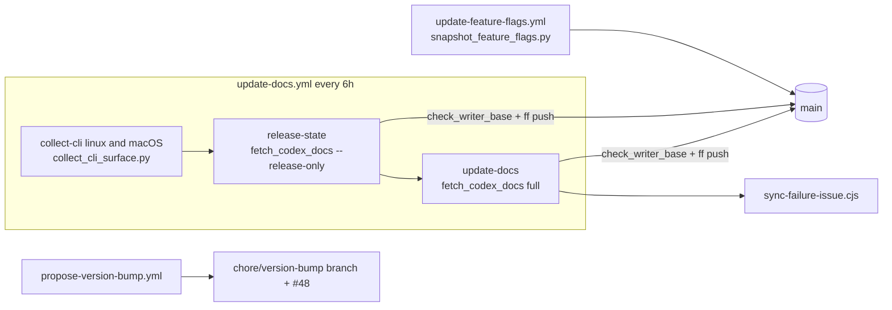

# Code quality and reliability audit — 2026-10-18

The audit and its closeout ran on October 18 UTC. All implementation changes are
DCO-signed and reviewed. No repository settings, secrets, branch protections, or
security policies were changed.

Each claim carries one of three labels:

- **Verified**: reproduced by executing code, tests, or Git/CI history.
- **Observed**: read in code or configuration but not executed.
- **Hypothesis**: not demonstrated.

Throwaway reproductions ran in temporary directories outside the checkout. Line
links point at the audited baseline unless stated otherwise.

[B-sync]: https://github.com/chenrui333/codex-docs/blob/73e43dfce4c3e82e36d318724a488aa5ead33bc4/scripts/fetch_codex_docs.py

## 1. Executive summary

The repository is in good operational health:

- Strict web sync recovered on September 20 after the localized Learn sitemap outage.
- All 97 scheduled documentation runs since then succeeded.
- The release-state transaction succeeded in 106 of 106 runs, including every
  web outage.
- No failed sync was ever committed.

There are no P0 findings. Since September 18 the only code changes were
Renovate dependency bumps. Most risk therefore sits in long-standing ordering
and fail-open paths inside the synchronizer, not in new regressions.

The highest-value open defect is **A1**, a verified write-ordering bug. A full
sync builds the feature-flag snapshot from the *previous* on-disk Learn config
docs. Over the last month it left `main` internally inconsistent eight times and
caused five unrelated PR check failures.

The other substantive risks share one shape: the synchronizer treats some
corrupt or partial local state as empty instead of failing closed. This affects
a corrupt manifest, the coverage report written before the transaction, and
change detection that compares against the manifest rather than the disk. CI
never publishes these states, because failed steps never commit. They do affect
local runs and uploaded diagnostics.

Three narrow fixes were completed:

- [#116](https://github.com/chenrui333/codex-docs/pull/116): `just check-strict` no longer fails falsely on Python byte-code. Merged.
- [#117](https://github.com/chenrui333/codex-docs/pull/117): local Python toolchain aligned with CI 3.15. Merged.
- [#118](https://github.com/chenrui333/codex-docs/pull/118): the feature-flag CLI subprocess now runs in the same isolated environment as help/prompt collection. Merged.

## 2. Audited baseline

- `origin/main` was fetched before auditing:
  [`73e43dfc`](https://github.com/chenrui333/codex-docs/commit/73e43dfce4c3e82e36d318724a488aa5ead33bc4).
  The local checkout was clean and fast-forwarded to it.
- Changes since the [September 18 audit](2026-09-18.md) were Renovate updates
  only:
  - ruff 0.16.9 → 0.17.1;
  - coverage 7.16.2;
  - Python 3.15 in workflows ([#114](https://github.com/chenrui333/codex-docs/pull/114));
  - action digests (#110, #111, #112).

  No synchronizer logic changed.
- Open issues: [#48](https://github.com/chenrui333/codex-docs/issues/48) (VERSION
  proposal) and [#17](https://github.com/chenrui333/codex-docs/issues/17)
  (dependency dashboard). There was no open sync incident and no open PR at
  baseline.

**Baseline checks**

| Check | Result | Duration |
| --- | --- | --- |
| `just setup` (Python 3.14.8, then 3.15.0) | pass | 3.5 s |
| `just lint` (actionlint v1.7.7, ruff 0.17.1) | pass | 4.1 s |
| Python tests | 110 pass on 3.14.8 and 3.15.0 | 0.3 s |
| Node tests | 21 pass | 6.2 s |
| Coverage | statements 84.81%, branches 74.50%, combined 81.90% (floor 70%) | — |
| Live `just check-strict` on a fresh worktree | **failed**: only the scope check, on `scripts/__pycache__/*.pyc` (A5) | 47 s |
| Live `just check-strict` with #116 applied | **pass**: two strict syncs, freshness `fresh` (0.163.0), idempotent, in scope | 51 s |

The live sync result is real upstream evidence. It is the first successful live
two-pass validation recorded by an audit; the September audit could only claim
offline fixture idempotence.

Determinism was also checked:

- Three sequential and five shuffled Python test runs gave identical outcomes.
- With sockets disabled, all tests still passed.

## 3. Architecture assessment

The three direct writers share the `docs-writer-main` concurrency group. Each
one checks for a stale base and pushes fast-forward only. Strict mode rejects
any recorded source failure before canonical writes. Release-only mode replays
the committed web families after a hash check.

The design is sound. Its weak points are the following.

**The synchronizer monolith.**
[`fetch_codex_docs.py`][B-sync] has 3,961 lines and 128 top-level definitions. The
largest functions:

| Function | Lines |
| --- | --- |
| `build_capability_inventory_file` | 488 |
| `main` | 422 |
| `discover_developers_urls` | 141 |
| `apply_sync` | 117 |

`main` mixes source collection, coverage assembly, and persistence. Both A1 and
A3 come from that coupling: disk state is read or written midway through what
should be a single plan → commit sequence.

**Duplicated helpers.**

- Equivalent HTTP and tag-resolution helpers exist in three scripts:
  - `fetch_json` appears three times;
  - `resolve_tag_commit` appears twice;
  - `fetch_text` appears twice.
- Six front-matter helpers are AST-identical or near-identical between
  `fetch_codex_docs.py` and `snapshot_feature_flags.py`.
- The strict failure-count check is duplicated between `update-docs.yml` (inline
  Python) and `scripts/validate_sync.sh`.

This duplication is a maintenance cost but not yet a defect. The
`snapshot_feature_flags.py` copies use `urllib`, and they behave differently
from the `requests` copies (S2).

**Scripts outside the monolith.** The previously extracted pure modules
(`cli_help`, `cli_observations`, `model_catalog`, `semantic_history`) are small
and well tested (95–100%). #118 adds `codex_env.py`, a stdlib-only module, as
the single subprocess-isolation boundary.

## 4. Confirmed defects

| ID | Sev | Finding | Evidence | Status |
| --- | --- | --- | --- | --- |
| A1 | P1 | During a full sync, `build_snapshot()` reads `CONFIG_*_DOC` from disk ([fetch:3734][B-a1a], [snapshot:789-801][B-a1b]) **before** `apply_sync` writes the new Learn files ([fetch:3922][B-a1c]). When a sync changes a Learn config doc, `docs/feature-flags/lifecycle.json` records the previous hash. | **Verified.** Over the last month, 8 sync commits on first-parent `main` recorded `config_reference.sha256` equal to the parent's file hash: `613f2408`, `319fe032`, `2f58e801`, `f4443815`, `28b4da7f`, `86ec2ae9`, `f821ceb5`, `67f777f1`. Each was healed 2–7.5 h later by a release or feature commit. During those windows, `validate-feature-flags` failed on 5 unrelated PRs, for example [run 38726067862](https://github.com/chenrui333/codex-docs/actions/runs/38726067862). Tests mock `build_snapshot`, so the ordering is never exercised. | Open. Next PR #1. |
| A2 | P2 | A corrupt manifest is treated as empty during a full sync ([fetch:1397-1424][B-a2]). | **Verified.** Effects: removed files stay on disk unmanaged forever; failed families lose their manifest entries; everything is reported as "added". A `[]` manifest crashes with `AttributeError`. Release-only mode correctly refuses. | Open. Next PR #2. |
| A3 | P2 | Write ordering and reconciliation inside the transaction: (a) `write_coverage` runs before `apply_sync` ([fetch:3905][B-a3a]); (b) only manifest-hash changes are written ([fetch:3434-3437][B-a3b]); (c) the manifest is written before the summary and the weekly event; (d) every write truncates in place. | **Verified** with injected faults. A failing `apply_sync` still advances coverage (CLI version and `last_successful_full_sync_at`), which CI uploads as an artifact. A file left at the wrong bytes is never repaired if upstream returns to the manifest hash. A failure after the manifest write permanently loses that change's weekly event. | Open. Next PR #2. The simplest repair is planned below; no transaction framework is needed. |
| A4 | P2 | Feature-flag introspection and the sync's `codex --version` passed the full parent environment minus two GitHub token names, plus the real `HOME`/`CODEX_HOME` and the checkout as working directory. | **Verified** with a fake CLI. API keys, AWS keys, `ACTIONS_RUNTIME_TOKEN`, `SSH_AUTH_SOCK`, and GitHub tokens under other names all reached the child. The real 0.163.0 `--version` also writes under the inherited `$CODEX_HOME/tmp`. No secret reached a generated artifact. | Fixed in [#118](https://github.com/chenrui333/codex-docs/pull/118). |
| A5 | P2 | `scripts/validate_sync.sh` hashes the whole tree, including gitignored byte-code. `just check-strict` therefore fails on every fresh checkout and after any script edit. | **Verified** live: the only violations were `scripts/__pycache__/*.pyc`. | Fixed in [#116](https://github.com/chenrui333/codex-docs/pull/116) (`PYTHONDONTWRITEBYTECODE=1`, plus a stub-generator test that also proves real out-of-scope writes still fail). |
| A6 | P2 | Renovate never automerges GitHub Action **digest** updates. The global `minimumReleaseAge: "2 days"` ([renovate.json:6-10][B-a6]) cannot be satisfied for digests, so `renovate/stability-days` stays pending. | **Verified.** #110 and #112 waited 8–9 days and were merged by hand. Each was rebased about 25 times, which accounts for 48 of 70 Lint PR runs and 48 of 49 feature-flag PR runs in the window. Matches [renovate#45236](https://github.com/renovatebot/renovate/issues/45236). | Open. Next PR #3 (config only). |
| A7 | P3 | The scheduled "Generate feature lifecycle snapshot" step ([update-feature-flags.yml:125-126][B-a7]) calls the GitHub API without `GITHUB_TOKEN`. | **Verified**: [run 36884151393](https://github.com/chenrui333/codex-docs/actions/runs/36884151393) failed with `HTTP Error 403: rate limit exceeded`. | Open. Next PR #3. |
| A8 | P3 | CI moved to Python 3.15 in #114, but `justfile`, `pyproject.toml`, and `README.md` still targeted 3.14. | **Verified.** | Fixed in [#117](https://github.com/chenrui333/codex-docs/pull/117). Renovate updates only the workflows, so the next minor bump needs the same manual follow-up. |

[B-a1a]: https://github.com/chenrui333/codex-docs/blob/73e43dfce4c3e82e36d318724a488aa5ead33bc4/scripts/fetch_codex_docs.py#L3734
[B-a1b]: https://github.com/chenrui333/codex-docs/blob/73e43dfce4c3e82e36d318724a488aa5ead33bc4/scripts/snapshot_feature_flags.py#L789-L801
[B-a1c]: https://github.com/chenrui333/codex-docs/blob/73e43dfce4c3e82e36d318724a488aa5ead33bc4/scripts/fetch_codex_docs.py#L3922
[B-a2]: https://github.com/chenrui333/codex-docs/blob/73e43dfce4c3e82e36d318724a488aa5ead33bc4/scripts/fetch_codex_docs.py#L1397-L1424
[B-a3a]: https://github.com/chenrui333/codex-docs/blob/73e43dfce4c3e82e36d318724a488aa5ead33bc4/scripts/fetch_codex_docs.py#L3905
[B-a3b]: https://github.com/chenrui333/codex-docs/blob/73e43dfce4c3e82e36d318724a488aa5ead33bc4/scripts/fetch_codex_docs.py#L3434-L3451
[B-a6]: https://github.com/chenrui333/codex-docs/blob/73e43dfce4c3e82e36d318724a488aa5ead33bc4/renovate.json#L6-L10
[B-a7]: https://github.com/chenrui333/codex-docs/blob/73e43dfce4c3e82e36d318724a488aa5ead33bc4/.github/workflows/update-feature-flags.yml#L122-L126

## 5. Reliability and security findings

Exploitability is classified by what was demonstrated. All S items are P3.

| ID | Finding | Exploitability | Evidence |
| --- | --- | --- | --- |
| S1 | A redirect to another host or to `http` is followed and mirrored under the original path ([fetch:580-587][B-s1]). There is no final-host allowlist. This was a September carry-over and remains unresolved. | Needs an upstream open redirect or compromise; not demonstrated against the real hosts. The GitHub token *is* stripped on cross-host redirects by `requests`. | **Verified** against local servers. The committed manifest records `redirects: {}`, so an allowlist would break nothing today. |
| S2 | `snapshot_feature_flags.fetch_json` uses `urllib`, which forwards `Authorization` across a cross-host redirect. HTTP errors also escape `main()` as tracebacks, though they still fail closed. | Not exploitable unless api.github.com redirects off-host. | **Verified** with a loopback redirect probe. |
| S3 | URL-derived paths are validated only at write time, so `..` segments fail mid-write ([fetch:1448-1456][B-s3]). A symlinked managed directory redirects writes and deletions outside the root. This was a September carry-over. | Path traversal needs an OpenAI-advertised sitemap URL. The symlink case needs repository write access; the tree has 0 symlinks. | **Verified.** |
| S4 | The GitHub tree `truncated` flag is ignored, and a non-object response becomes an empty list ([fetch:1249-1265][B-s4]). Strict mode then **deletes** the files that were not listed. | Needs a GitHub API anomaly; today's tree is complete (10,157 entries, `truncated: false`). | **Verified** with fixtures. |
| S5 | In `update-feature-flags.yml`, the PR job interpolates PR-controlled `lifecycle.json` values with `${{ }}` inside `run:`, and the version regex permits shell metacharacters. | No privilege gain: `pull_request` with `contents: read` and no secrets, and the PR author already controls the script. | **Verified** that the regex accepts the payload; injection not executed. |
| S6 | `git log/show` for historical CLI observations ([fetch:2238-2248][B-s6]) inherits the full environment and `~/.gitconfig`. With `log.showSignature=true`, its parsing breaks. | Dormant; the path runs only when `docs/cli-surface/*.json` is missing. | **Verified** in a temporary repository. |
| S7 | `check_codex_freshness.py` catches only three exception types. Malformed inputs or a CLI timeout therefore leave the *previous* `freshness.json` in place, and CI uploads it. | Integrity of diagnostics only. | **Verified**. |

[B-s1]: https://github.com/chenrui333/codex-docs/blob/73e43dfce4c3e82e36d318724a488aa5ead33bc4/scripts/fetch_codex_docs.py#L580-L587
[B-s3]: https://github.com/chenrui333/codex-docs/blob/73e43dfce4c3e82e36d318724a488aa5ead33bc4/scripts/fetch_codex_docs.py#L1448-L1456
[B-s4]: https://github.com/chenrui333/codex-docs/blob/73e43dfce4c3e82e36d318724a488aa5ead33bc4/scripts/fetch_codex_docs.py#L1249-L1265
[B-s6]: https://github.com/chenrui333/codex-docs/blob/73e43dfce4c3e82e36d318724a488aa5ead33bc4/scripts/fetch_codex_docs.py#L2238-L2248

**Robust, no change recommended:**

- **Strict gate.** Strict mode rejects failures before any canonical write. Seven
  behavioural tests kill a mutation that disables it.
- **CI publication.** CI never commits a failed sync: both commit steps are gated
  on step success with `pipefail`.
- **Writers.**
  - Writes are fast-forward only, after `check_writer_base.py`.
  - A force-pushed remote fails safely (verified with real Git).
  - There were 0 push races in the window.
- **Untrusted input parsing.**
  - Tag and commit SHAs must be full 40-hex.
  - Tag dereferencing is bounded at five hops and restricted to the `openai/codex` API prefix.
  - There is no archive extraction.
  - Temporary directories are random and self-cleaning.
- **Artifact scan.** No local paths, temporary directories, or token patterns
  appear in generated CLI, prompt, skill, model, or feature artifacts. The only
  user-path strings are upstream examples such as `/Users/me`.
- **Workflow hygiene.**
  - All `uses:` references are pinned to 40-character SHAs.
  - Every job has `timeout-minutes`.
  - Every checkout except `release.yml` disables persisted credentials.
- **Incident handling (#99).** Bounded incident handling held during the
  September outage: one body rewrite, then one recovery comment.
- **VERSION proposal (#100).** The October run took the `creation_disabled` path,
  refreshed the VERSION-only branch, and rewrote #48 without new comments. Its
  branch is two bot commits ahead of `main`, VERSION only. No action is needed
  beyond the owner deciding whether to release `0.1.1`.

## 6. Maintainability opportunities

| ID | Opportunity | Benefit | How behaviour preservation is proven |
| --- | --- | --- | --- |
| M1 | Split `apply_sync` into a pure `plan_sync` plus `commit_plan` (validate all paths → reconcile files → deletions → events → manifest last via `os.replace`) and `report_plan`. | Resolves A3 and makes the transaction testable without patching module globals. | Table-test the planned results against the baseline; two-pass fixture trees stay byte-identical. |
| M2 | Pass in-transaction file contents to the feature snapshot instead of disk paths. | Resolves A1 and removes hidden disk coupling from `main`. | A full-mode regression test that leaves `build_snapshot` unmocked. |
| M3 | Extract coverage assembly from `main` (about 130 lines) into `assemble_coverage(...)`. | `main` shrinks to orchestration. | `ast.dump` equality of the moved statements (the #104 method), plus coverage-dict equality in the existing fixtures. |
| M4 | Split `build_capability_inventory_file` by family, with module-level helpers. | The 488-line function becomes six readable units. | A golden test built from the committed inventory inputs, byte-compared before and after. |
| M5 | Share one stdlib HTTP/tag helper between `snapshot_feature_flags.py` and `check_codex_freshness.py`. | Removes duplicate tag dereferencing. Fixes S2 once. | The existing tag-resolution tests run against both callers. |

Deliberately **not** recommended:

- A general transaction framework or journal. Git plus "manifest last, atomic
  replace, reconcile from plan" is sufficient.
- Splitting the monolith into many small modules.
- pip/npm caching. It would save under 40 s of about 2.2 job-minutes per run.
- A degraded-success Learn policy. The September preconditions still apply.
- Broad lint or format rules and coverage-floor changes. The owner withdrew these
  with #102, and nothing new justifies revisiting them.

## 7. CI and test assessment

**Workflow history, September 18 – October 18.** All runs were read with
read-only `gh` calls.

| Workflow | Success | Failure | Cause |
| --- | --- | --- | --- |
| update-docs (schedule) | 97 | 9 | Upstream: localized Learn sitemap read timeout, 09-18 → 09-20. Last failure [35487726588](https://github.com/chenrui333/codex-docs/actions/runs/35487726588); recovery [35506124430](https://github.com/chenrui333/codex-docs/actions/runs/35506124430) |
| update-feature-flags (schedule) | 30 | 1 | Repository: missing token, rate limited (A7) |
| update-feature-flags (PR) | 44 | 5 | Repository: A1 drift on `main`, not caused by the PRs |
| lint | 85 | 0 | — |
| propose-version-bump | 1 | 0 | `creation_disabled`, handled as designed |

**Scheduler behaviour (GitHub infrastructure).** This affects timeliness, not
correctness.

- 16 of 122 six-hour slots (13%) produced no run.
- Median start delay was 237 minutes.

Moving crons off `:00` is an optional mitigation.

**Lower-value workflow items.** These are observed only; none failed in the
window.

- `release-state` and `update-docs` use `if: always()`. `${{ !cancelled() }}`
  would respect manual cancellation.
- `release.yml` persists checkout credentials, has no concurrency group, and
  creates the tag without `--target "$GITHUB_SHA"`.
- actionlint is pinned at v1.7.7. The latest is v1.7.12, and Renovate does not
  track it.

**Test gaps.** In a copy of the repository, 32 correctness-relevant conditionals
were mutated. 16 were caught; these 16 survived the suite:

- **Deletion of a confirmed-removed page.** Two mutations survive: never deleting
  and skipping the unlink. Today's behaviour is correct, but nothing protects it.
- **Per-platform CLI observation checks (four mutations).**
  `prepare_cli_observations` runs on the production release path. Four checks
  are untested there: commit mismatch, version skew, downgrade, and misnamed
  file.
- **Feature-snapshot release check (four mutations).** No test catches removing
  the version/commit check in sync `main`, the sync's tag resolver accepting a
  foreign URL or a non-semver version, or the freshness feature-commit check
  always passing.
- **Release-only empty-manifest guard.** With the guard removed, a release-only
  sync drops every web document and still reports success.
- **Redirect recording and developers-site 404 handling.**
- **Second push step's stale-base guard.** The test matches workflow text, not
  per-step conditions.
- **Invalid-manifest behaviour.** It is unspecified.
- **macOS prompt-path replacement.** CI tests run on Linux only.

Weak tests:

- **`test_main_success_and_strict_partial_failure`** patches 23 objects. Its
  strict branch passes even with the strict gate removed, because
  [fetch:3947-3949][B-dead] is unreachable and returns 1 anyway.
- **The feature-snapshot `main` test** hashes the real mirrored Learn docs, so it
  breaks if upstream moves that page.
- **The weekly-report test** reads the clock twice, so it can fail across UTC
  midnight.

Not caught by any test today: interrupted multi-file writes (A3), redirects to a
foreign host (S1), and a symlinked parent directory (S3).

[B-dead]: https://github.com/chenrui333/codex-docs/blob/73e43dfce4c3e82e36d318724a488aa5ead33bc4/scripts/fetch_codex_docs.py#L3947-L3949

## 8. Prioritized improvement backlog

Priority ≈ impact × confidence ÷ (effort × regression risk), judged
qualitatively.

| Rank | Item | Sev | Effort | Risk | Kind |
| --- | --- | --- | --- | --- | --- |
| 1 | A1: feature snapshot uses in-transaction Learn docs | P1 | M | low | Medium |
| 2 | A2: fail closed on an unreadable manifest, validated before any write | P2 | S | low | Quick win |
| 3 | A3: coverage after `apply_sync`; reconcile every planned file; manifest last and atomic | P2 | S–M | low–med | Medium |
| 4 | A6 + A7: Renovate digests skip `minimumReleaseAge`; token on the scheduled feature step | P2/P3 | S | very low | Quick win |
| 5 | Tests for deletion, platform-observation checks, release-version disagreement, and the empty-manifest guard | P2 | S | none | Quick win |
| 6 | S4: reject a truncated or malformed GitHub tree | P3 | S | low | Quick win |
| 7 | S1/S3: final-host allowlist; reject `..` when deriving paths; refuse symlinked targets | P3 | S | low | Quick win |
| 8 | Per-step workflow writer test; remove the unreachable strict check; de-mock the strict test | P3 | S | low | Quick win |
| 9 | S7: freshness writes an unhealthy report on any exception | P3 | S | low | Quick win |
| 10 | M1/M3: `apply_sync` plan/commit split; coverage assembly extraction | P2 | M | med | Medium |
| 11 | M5 + S2: shared stdlib HTTP/tag helper with redirect auth stripping | P3 | S | low | Medium |
| 12 | Workflow polish: `!cancelled()`, release hardening, actionlint tracking, off-hour crons | P3 | S | low | Quick win |
| 13 | M4: capability inventory split by family | P3 | L | med | Larger, after 10 |

## 9. Recommended implementation sequence

1. **A1.** Add `documents: Mapping[Path, str]` to `build_snapshot`. In full mode,
   pass it the exact bytes `apply_sync` will write. The regression test runs
   `main()` with a changed config doc and an unmocked snapshot, then asserts the
   recorded hash equals the hash of the written file and that a second pass is
   identical.
2. **A2 + A3.**
   - `load_existing_manifest` raises when the file exists but is invalid, checked
     at the top of `main`.
   - `write_coverage` moves after a successful `apply_sync`.
   - `apply_sync` resolves all targets first, then calls `write_file_if_changed`
     for every planned file, writes the weekly event before the manifest, and
     writes the manifest last via a temporary file and `os.replace`.

   Tests inject a failure on the third write and verify that the next run
   reconciles the disk.
3. **A6 + A7.** Add `{"matchUpdateTypes": ["digest"], "minimumReleaseAge": null}`
   and `GITHUB_TOKEN: ${{ github.token }}` on the scheduled feature step.
4. **Test-only PR** for the surviving mutations listed in §7.
5. **Optional hardening:** S1, S3, S4, then the M1/M3 extractions once items 1–2
   have added test cover.

Estimated total for items 1–4: about two to three focused engineer-days.
Item 5 and M4 add about two more.

## 10. Completed fixes

| PR | Change | Validation | State |
| --- | --- | --- | --- |
| [#116](https://github.com/chenrui333/codex-docs/pull/116) | `validate_sync.sh` disables byte-code writes. A new stub-generator test covers both the false positive and a genuine out-of-scope write. | Test failed before the fix and passes after. Full suite and lint pass. Live `just check-strict` passes on a fresh worktree. | Merged as `1a93b653` after a clean Codex review |
| [#117](https://github.com/chenrui333/codex-docs/pull/117) | `justfile`, ruff target, and README moved to Python 3.15. | `just setup`, `just lint`, and `just test` on 3.15.0. | Merged as `3f7db108`. A Codex DCO finding was a false positive: the commit carries `Signed-off-by`. Replied with evidence and resolved. |
| [#118](https://github.com/chenrui333/codex-docs/pull/118) | `scripts/codex_env.py` is the single isolation boundary for every Codex CLI subprocess; the denylist helpers are deleted. `update-feature-flags.yml` validates snapshots when that module changes. | The fake-CLI test failed on baseline ("inherited a credential") and passes after. A live strict sync on real 0.163.0 produced byte-identical feature-flag, capability, CLI-surface, prompt, skill, and manifest output. | Merged as `4c3f1d18`. Codex's path-filter finding was fixed in `799d8f1c` and re-reviewed clean. |

On `main` at `4c3f1d18`, `just lint` passes. There are 112 Python tests and 21
Node tests. Coverage is 85.19% statements, 74.96% branches, and 82.31% combined.

## 11. Comparison with September 18, open questions, and limits

**Comparison with September 18:**

- **Resolved since then:**
  - Learn outage recovered upstream.
  - Strict policy validated.
  - Live two-pass idempotence demonstrated.
  - Feature-process isolation fixed (#118).
- **Still open from September:**
  - Redirect trust (S1).
  - Symlink containment (S3).
  - Write rollback, now refined into the concrete A2/A3 plan.
  - Transitive dependency locking.
- **New:** A1, A5, A6, A7, A8, and the test-gap inventory.
- **Regression-verified as still working:**
  - #99 incident bounding;
  - #100 VERSION recovery;
  - #103 repeat-run stability;
  - #105 fixture cleanup (Node suite stable).

**Questions for the owner:**

- Should `0.1.1` be released, or should #48 stay open?
- Should Renovate also own the local Python and actionlint references? A custom
  manager is possible but was not tested.
- Should A1's fix also regenerate the snapshot when only Learn content changes,
  or only when the config docs change?

**Limits:**

- Live syncs ran on macOS. The local output differs from canonical Linux output
  only in `observation_environment`, which is expected and was not committed.
- Workflow durations and history come from GitHub metadata; no workflow was
  dispatched.
- Mutation testing covered 32 selected guards, not the whole program.
- During the audit, one test file in the primary checkout was accidentally
  edited and immediately restored byte-for-byte (`tests/test_fetch_codex_docs_extended.py`).
  The only lasting trace was a new modification time.

## 12. Follow-up hardening session (October 18)

Implementation began at `2d242307`. Owner-authorized serial review and merging
began at `048c76c3`; the six implementation PRs are now merged. This documentation
closeout is [#126](https://github.com/chenrui333/codex-docs/pull/126). One operator
updated branches and merged PRs, using ordinary merges without force pushes or
repository-setting changes. Every implementation commit has a DCO sign-off.

| PR | Final reviewed head | Merge commit | Result |
| --- | --- | --- | --- |
| [#120](https://github.com/chenrui333/codex-docs/pull/120) | `b8776d69` | `8e89232a` | Action digest/pinDigest updates use scoped `timestamp-optional`; the two-day release-age policy and automerge eligibility for other update types are unchanged. |
| [#121](https://github.com/chenrui333/codex-docs/pull/121) | `26ceeb3d` | `e68e6c02` | Feature snapshots use the same annotated Learn config text that the transaction writes; removed required docs fail closed. |
| [#122](https://github.com/chenrui333/codex-docs/pull/122) | `734de27c` | `64fd0b62` | Scheduled API reads are authenticated; cross-origin redirects strip Authorization; HTTP failures are reported cleanly. CLI subprocess isolation remains intact. |
| [#124](https://github.com/chenrui333/codex-docs/pull/124) | `56206b91` | `3f77e827` | Fail-closed manifests, explicit generated-path ownership, verified CLI cache recovery, disk reconciliation, atomic manifest replacement, and post-commit reports. |
| [#125](https://github.com/chenrui333/codex-docs/pull/125) | `e4f1e08f` | `92da175c` | GitHub listings require explicit `truncated: false`, a valid tree, and mirrored Markdown; incomplete listings block rather than prune the family. |
| [#123](https://github.com/chenrui333/codex-docs/pull/123) | `bd871074` | `6bd8e7c1` | Tests only: 19 safety regressions, minimal subprocess environments, and manifest-verified platform fixtures. |

All six had completed clean Codex reviews of these exact heads and no unresolved
threads at merge time. Applicable CI passed. #120 has no configured checks and
instead passed local Renovate 44.167.1 configuration validation. Its validator
warned that the cached native RE2 module did not match Node 24 and used the
JavaScript-regex fallback. This does not prove future automerge behavior.

**Additional recovery fixes required by current-head reviews of #124:**

- Validate manifest schema, required source/hash fields, safe canonical path
  spelling, and generator ownership before collection. A corrupt manifest cannot
  claim maintained `docs/README.md` or `docs/feature-flags/README.md`.
- Limit cleanup to generated subtrees and exact singleton outputs. Preserve
  maintained skill/prompt siblings and feature documentation while removing
  orphaned platform, lifecycle, capability, CLI, and model outputs.
- Verify every reused platform observation against its manifest hash, including
  manifest-listed missing files. Rebuild missing, corrupt, or untracked caches only
  from fresh same-platform evidence without downgrading committed release
  provenance; otherwise fail closed with restoration guidance.
- Leave the committed summary and coverage untouched when no source produces
  files, even in non-strict mode. Failure attempts belong in logs/diagnostics.
- The summary carries the digest of the manifest it describes. Coverage advances
  only after the file transaction commits. Multi-file writes are recoverable,
  not crash-atomic.

**Executable evidence on merged functional main `6bd8e7c1`:**

- `just setup`, `just lint`, and `just test` pass: **174 Python tests, 21 Node
  tests; 88.72% statement, 79.63% branch, and 86.16% combined coverage**.
  Compared with the previous 165-test integration, recovery coverage added ten
  tests and replaced one obsolete mock-echo test with behavioral assertions.
- All 26 mutation scenarios were replayed in temporary copies. Their clean
  baselines pass and their broken variants fail. M3c now disables both explicit
  deletion and its independent orphan-cleanup fallback to recreate the same
  consumer-visible missing-deletion defect.
- Authenticated live `just check-strict` passes with CLI `0.163.0`: both strict
  synchronizations succeed, canonical output is idempotent, and freshness is
  `fresh` with all 21 freshness checks passing.
- Standalone `just feature-flags` is byte-identical to the synchronized snapshot.
  After staging only the local generated lifecycle outputs, the documented
  index-based `just check-feature-flags` also passes.
- All 289 manifest entries match disk. The summary digest matches the manifest;
  models, feature flags, CLI union, platform evidence, coverage, and Learn
  documentation hashes agree on their provenance.
- `just sync-release` followed by a strict full sync changes no generated bytes.
  Validation output is discarded locally, not manually committed. The next
  scheduled writer may legitimately introduce `manifest_sha256` into the
  canonical summary.
- The #121/#122 import conflict was resolved in #122 and re-reviewed. A local
  Node cleanup race came from the workstation's Git-AI wrapper writing `.git/ai`;
  fixture validation passed with ordinary Git and global hooks disabled.

**Deliberately retained limits and external checks:**

- Cross-host document redirects remain accepted and recorded; generated-output
  symlinks remain a local trust-boundary risk. The current generated tree has no
  symlinks. These known residual risks were not expanded into new work.
- A failed local transaction can retain a weekly event if upstream inputs change
  before a retry. CI never publishes a failed working tree. No claim of full
  filesystem crash atomicity is made.
- The earlier capability churn observed without an API token remains unexplained;
  authenticated closeout validation did not reproduce it.
- Observe the next eligible Renovate digest PR before claiming end-to-end
  automerge success; see [renovate#45236](https://github.com/renovatebot/renovate/issues/45236).
- Credential rotation for the previously exposed `CLOUDFLARE_API_KEY` remains an
  owner action if not already completed. Its value was not inspected or reproduced.

The repository is ready for routine maintenance after this closeout. No remaining
confirmed issue requires another dedicated reliability session.

During the earlier implementation session, a delegated worker briefly edited the
primary checkout instead of its worktree, then moved and restored those edits.
The merge closeout made changes only in isolated worktrees.
